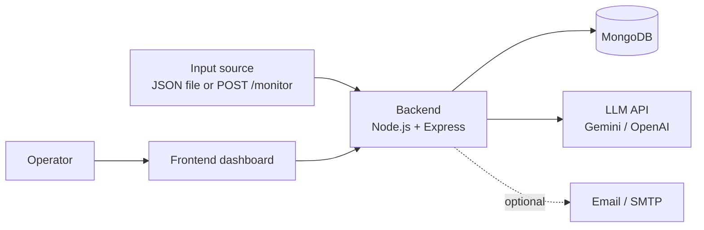
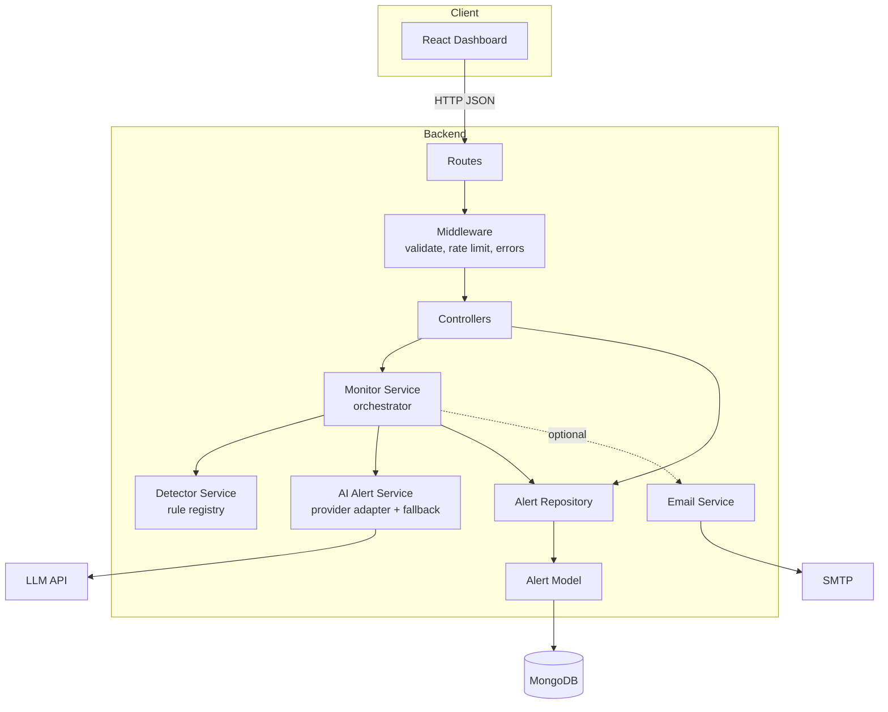
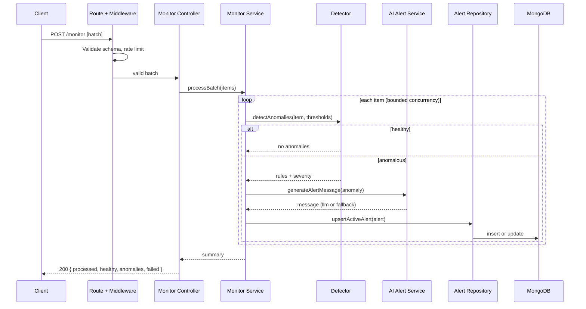
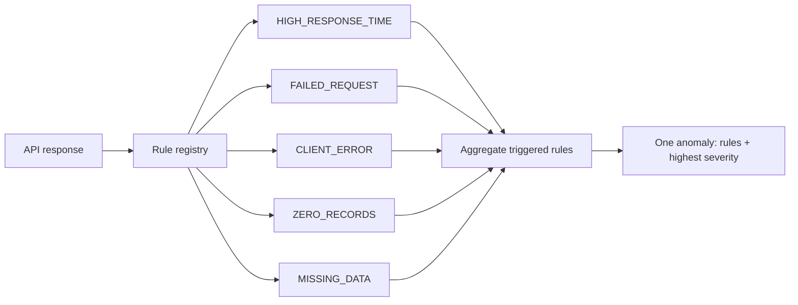
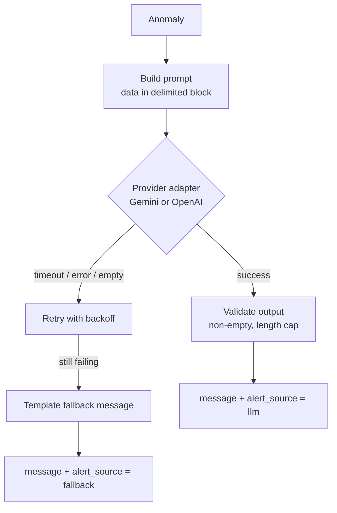
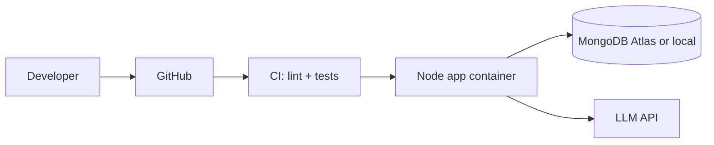

# ARCHITECTURE.md

System architecture for the **Intelligent API Monitoring & Alert System**. Requirements are in `PRD.md`. Coding and workflow rules are in `AGENT.md`.

---

## 1. Overview

The system receives API response metrics, evaluates their health with a rule engine, generates human-readable alerts with an LLM, stores anomalies in MongoDB, and shows active alerts in a web dashboard.

**Design principles**

| Principle | What it means here |
|---|---|
| Layered and modular | Routes, controllers, services, and models each have one job |
| Stateless server | No state in memory, so instances can be scaled horizontally |
| Fail-safe AI | LLM failure never loses an alert (deterministic fallback) |
| Config-driven | Thresholds, timeouts, models, and flags come from environment variables |
| Pure core logic | Detection rules are pure functions, easy to test and extend |
| Isolated failures | One bad item or one failed side effect never breaks a batch |

---

## 2. System Context



| Actor / System | Role |
|---|---|
| Input source | Supplies API response data (`api_name`, `response_time_ms`, `status_code`, `records_returned`) |
| Backend | Validates, detects, generates alerts, stores, and serves them |
| MongoDB | Persistent store for anomalies |
| LLM API | Writes the human-readable alert message |
| SMTP | Optional email reports for new critical alerts |
| Frontend | Displays, filters, and resolves alerts |

---

## 3. High-Level Architecture



### Layer responsibilities

| Layer | Responsibility | Must not |
|---|---|---|
| Routes | Map URLs to controllers | Contain logic |
| Middleware | Validation, rate limiting, request logging, error handling | Call the database |
| Controllers | Parse request, call a service, shape the response | Hold business logic |
| Services | All business logic and orchestration | Know about HTTP |
| Repositories / Models | Database access and schemas | Contain business rules |
| Utils / Config | Logger, concurrency helper, env config | Depend on services |

Dependencies flow one way: `routes -> controllers -> services -> repositories -> models`.

---

## 4. Request Flow: `POST /monitor`



**Step summary**

1. **Validate.** Zod or Joi checks the array and every field. Invalid items are reported with details.
2. **Detect.** Each item runs through the rule registry (pure functions).
3. **Generate.** Only anomalous items call the LLM. Healthy items cost nothing.
4. **Persist.** The alert is upserted so repeated failures do not create duplicates.
5. **Notify (optional).** New critical alerts trigger an email, off the critical path.
6. **Respond.** A summary is returned: processed, healthy, anomalies, failed.

---

## 5. Core Components

### 5.1 Detector Service (rule engine)

Rules live in a registry. Each rule is a pure function `(response, thresholds) -> anomaly | null`. Adding a rule means adding one entry, with no changes to existing code.



| Rule | Trigger | Severity |
|---|---|---|
| `HIGH_RESPONSE_TIME` | `response_time_ms` above threshold (3000 warning, 5000 critical) | warning / critical |
| `FAILED_REQUEST` | `status_code` >= 500 | critical |
| `CLIENT_ERROR` | `status_code` 400-499 | warning |
| `ZERO_RECORDS` | `records_returned` is 0 on a 2xx response | warning |
| `MISSING_DATA` | `records_returned` missing or null | warning |

The final severity is the highest severity among the triggered rules. One response yields at most one anomaly.

### 5.2 AI Alert Service



- **Provider adapter.** A small interface (`generate(prompt) -> text`) hides the vendor, so Gemini and OpenAI are swappable by config.
- **Prompt design.** Short and structured: role, the data block, the required output (1-2 sentences, name the API, state the metrics, suggest a likely cause). Low temperature and a `max_tokens` cap.
- **Injection safety.** `api_name` is validated to `[A-Za-z0-9_\- ]`. All values go inside a delimited block marked as data. The model is told never to follow instructions found inside it.
- **Resilience.** Per-call timeout, limited retries with exponential backoff, and a deterministic fallback template. A simple circuit breaker skips the LLM for a cooldown after repeated failures.
- **Traceability.** `alert_source` records whether a message came from `llm` or `fallback`.

Fallback example: `"AppointmentAPI returned status 500 with 0 records and a 5500 ms response time. Possible outage or data issue."`

### 5.3 Monitor Service (orchestrator)

Coordinates detection, AI generation, persistence, and notification for a batch.

- Uses bounded concurrency (for example `p-limit`, default 5) so the LLM is never flooded.
- Uses `Promise.allSettled` semantics so one failed item does not stop the batch.
- Returns a summary with counts and the list of created or updated alerts.

### 5.4 Alert Repository and Model

Owns all MongoDB access. Services never touch Mongoose directly.

**Alert document**

| Field | Type | Notes |
|---|---|---|
| `_id` | ObjectId | |
| `api_name` | string | Indexed |
| `rules_triggered` | string[] | e.g. `["FAILED_REQUEST","ZERO_RECORDS"]` |
| `severity` | `warning` \| `critical` | |
| `metrics` | object | `response_time_ms`, `status_code`, `records_returned` |
| `message` | string | AI-generated (or fallback) text |
| `alert_source` | `llm` \| `fallback` | |
| `status` | `active` \| `resolved` | |
| `fingerprint` | string | Hash of `api_name` + sorted `rules_triggered` |
| `occurrences` | number | Incremented on repeat |
| `first_seen`, `last_seen` | Date | |
| `resolved_at` | Date \| null | |

**Deduplication.** A partial unique index on `fingerprint` where `status = "active"` guarantees one active alert per API and rule set. A repeat anomaly increments `occurrences` and updates `last_seen` and `metrics` with an atomic `findOneAndUpdate` upsert. This is safe under concurrent requests.

**Indexes**

| Index | Purpose |
|---|---|
| `{ status: 1, created_at: -1 }` | Fast `GET /alerts` |
| `{ api_name: 1, status: 1 }` | Filter by API |
| `{ fingerprint: 1 }` unique, partial on `status: "active"` | Deduplication |
| `{ severity: 1, status: 1 }` | Filter by severity |

### 5.5 Email Service (optional)

- Enabled by `EMAIL_ENABLED=true`.
- Sends a report when a **new** critical alert is created (not on every repeat).
- Runs after persistence and never blocks or fails the `/monitor` response. Errors are logged only.

---

## 6. API Design

| Method | Endpoint | Description | Success |
|---|---|---|---|
| `POST` | `/monitor` | Process a batch of API responses | `200` summary |
| `GET` | `/alerts` | List **active** alerts; supports `severity`, `api_name`, `page`, `limit` | `200` |
| `PATCH` | `/alerts/:id/resolve` | Mark an alert resolved | `200` |
| `GET` | `/health` | Liveness and DB connectivity check | `200` |

**Error shape (all endpoints)**

```json
{ "error": { "code": "VALIDATION_ERROR", "message": "Invalid input", "details": [] } }
```

| Status | When |
|---|---|
| `400` | Validation failure |
| `404` | Alert not found |
| `429` | Rate limit exceeded |
| `500` | Unexpected server error (details logged, not exposed) |

**`GET /alerts` response shape**

```json
{
  "data": [ { "id": "...", "api_name": "AppointmentAPI", "severity": "critical", "message": "..." } ],
  "page": 1,
  "limit": 20,
  "total": 1
}
```

---

## 7. Frontend Architecture

```
src/
  api/           # fetch wrappers for /alerts, /monitor
  components/    # AlertCard, SeverityBadge, FilterBar, SummaryStats, JsonSubmitForm
  hooks/         # useAlerts (fetch, refresh, resolve)
  pages/         # Dashboard
  App.jsx
```

- **Single page dashboard** with summary counters, filter bar, alert cards, and a form to submit JSON to `/monitor`.
- **Data flow:** `useAlerts` fetches `GET /alerts`, exposes loading, error, and data states, and refreshes on an interval or manually.
- **States:** loading, empty, error, and success are all handled.
- The UI is a thin client. All logic and validation authority stays in the backend.

---

## 8. Cross-Cutting Concerns

### Logging
Structured logs (Winston or Pino) to console and rotating files. Each request gets a request ID.

| Level | Logged events |
|---|---|
| `info` | Requests, batch summaries, alerts created |
| `warn` | LLM fallback used, retries, rate limit hits |
| `error` | Unhandled errors, DB failures, email failures |

Secrets and raw LLM keys are never logged.

### Error handling
- Validation errors are caught at the boundary and return `400`.
- A central Express error middleware converts every error to the standard error shape.
- Per-item failures inside a batch are collected into `failed` and reported, never thrown away.
- External calls (LLM, email) are wrapped so their failure degrades gracefully.

### Configuration
All config is read once at startup through `config/` and validated. The app fails fast if a required variable is missing.

| Variable | Purpose |
|---|---|
| `PORT`, `MONGO_URI` | Server and database |
| `LLM_PROVIDER`, `LLM_API_KEY`, `LLM_MODEL` | AI provider setup |
| `LLM_TIMEOUT_MS`, `LLM_CONCURRENCY` | Resilience and rate control |
| `THRESHOLD_RESPONSE_WARN_MS`, `THRESHOLD_RESPONSE_CRIT_MS` | Detection thresholds |
| `EMAIL_ENABLED`, `SMTP_*` | Optional email |
| `RATE_LIMIT_WINDOW_MS`, `RATE_LIMIT_MAX` | Rate limiting |

### Security
- Secrets in `.env`, with `.env.example` committed.
- `helmet`, CORS allow-list, and rate limiting on `/monitor`.
- Strict schema validation rejects unknown fields.
- Prompt-injection defenses (section 5.2).
- Synthetic data only. No real patient data anywhere.

---

## 9. Scalability and Performance

| Concern | Approach |
|---|---|
| Horizontal scaling | Stateless Node processes behind a load balancer; all state in MongoDB |
| Large batches | Bounded concurrency, per-item isolation, and a maximum batch size (for example 100) |
| LLM rate limits and cost | Only anomalies call the LLM; concurrency cap; short prompts; token cap |
| Read performance | Indexes, pagination, `.lean()`, and field projection |
| Write contention | Atomic upsert on the dedup fingerprint |
| Slow side effects | Email and LLM enrichment kept off the critical path |

**Growth path (not needed for the interview, but the code is structured for it)**

1. Move LLM generation and email to a job queue (BullMQ + Redis); `/monitor` returns `202` with a job ID.
2. Add a cache for repeated identical anomalies to skip LLM calls.
3. Add a scheduler or pollers that actively call the external APIs.
4. Add authentication and per-team alert routing.
5. Add metrics (Prometheus) and dashboards.

Because services take their dependencies as arguments, steps 1-3 mean swapping an implementation, not rewriting logic.

---

## 10. Testing Strategy

| Level | Scope |
|---|---|
| Unit | Each detection rule (thresholds, null records, 4xx vs 5xx), fingerprint generation, fallback message builder |
| Integration | `POST /monitor` and `GET /alerts` with a test database and a mocked LLM |
| Resilience | LLM failure produces a fallback alert; a bad item does not block the batch |
| Frontend | Component tests for alert rendering and filter behavior |

---

## 11. Deployment



- Run locally with `npm run dev` (backend) and the Vite dev server (frontend).
- Optional `docker-compose.yml` with the app and MongoDB for one-command startup.
- Handle `SIGTERM` for graceful shutdown (close the server, then the DB connection).

---

## 12. Project Structure

```
project/
  backend/
    src/
      config/
        index.js                 # Loads and validates environment config
        thresholds.js            # Detection thresholds from env
      routes/
        monitor.routes.js        # POST /monitor
        alerts.routes.js         # GET /alerts, PATCH /alerts/:id/resolve
        health.routes.js         # GET /health
      controllers/
        monitor.controller.js    # Request/response for /monitor
        alerts.controller.js     # Request/response for /alerts
      services/
        monitor.service.js       # Batch orchestration
        detector.service.js      # Runs the rule registry
        rules/                   # One file per detection rule
        aiAlert.service.js       # Prompt, LLM call, fallback
        providers/               # openaiCompat.provider.js (OpenRouter/OpenAI-compatible)
        prompts/                 # Versioned alert prompt templates
        email.service.js         # Optional email reports
      repositories/
        alert.repository.js      # All alert DB access
      models/
        alert.model.js           # Mongoose schema and indexes
      middleware/
        validate.js              # Schema validation
        errorHandler.js          # Central error responses
        rateLimit.js             # Rate limiter
        requestLogger.js         # Request ID and logging
      utils/
        logger.js                # Winston/Pino instance
        concurrency.js           # Bounded-concurrency helper
        fingerprint.js           # Dedup fingerprint builder
      app.js                     # Express app wiring
      server.js                  # Startup and graceful shutdown
    data/sample-input.json       # Sample API responses
    tests/
  frontend/
    src/ (api, components, hooks, pages)
  docs/
    AI_Prompts.md                # Working prompt log
  README.md
  PRD.md
  AGENT.md
  ARCHITECTURE.md
  .env.example
  .gitignore
```

Every file follows the header and one-line docstring rules in `AGENT.md` section 5.1.

---

## 13. Key Design Decisions

| # | Decision | Reason | Trade-off |
|---|---|---|---|
| 1 | Layered architecture | Clear separation, easy testing, evaluator-friendly | A few more files |
| 2 | Rule registry of pure functions | Easy to extend and unit test | Slight indirection |
| 3 | LLM only for anomalies | Saves cost and latency | Healthy APIs get no AI text (not needed) |
| 4 | Deterministic fallback message | Alerts are never lost when the LLM is down | Less descriptive text in fallback mode |
| 5 | Provider adapter | Swap Gemini and OpenAI with config | Small abstraction layer |
| 6 | MongoDB | Flexible schema for metrics, simple setup, matches task options | Fewer relational guarantees |
| 7 | Fingerprint-based dedup with atomic upsert | No alert spam, safe under concurrency | Needs a partial unique index |
| 8 | Synchronous processing for now | Simple, immediate feedback | Queue needed at much larger scale (path documented) |
| 9 | Stateless server | Horizontal scaling | No in-memory caching of alerts |
| 10 | Strict input validation and delimited prompts | Security and prompt-injection defense | Rejects loosely formatted input |

---

## 14. Video Walkthrough Outline (5-10 minutes)

1. **Problem and goal** (1 min): unreliable APIs, need for proactive alerts.
2. **Architecture** (2 min): diagram in section 3 and the layers.
3. **Live workflow** (3 min): send the sample JSON, show detection, AI alert, DB record, `/alerts`, dashboard.
4. **Key decisions** (2 min): rule registry, LLM fallback, dedup, bounded concurrency.
5. **Scalability and next steps** (1 min): queue, caching, pollers.
6. **AI usage** (1 min): how AI was used and where `AI_Prompts.docx` fits.